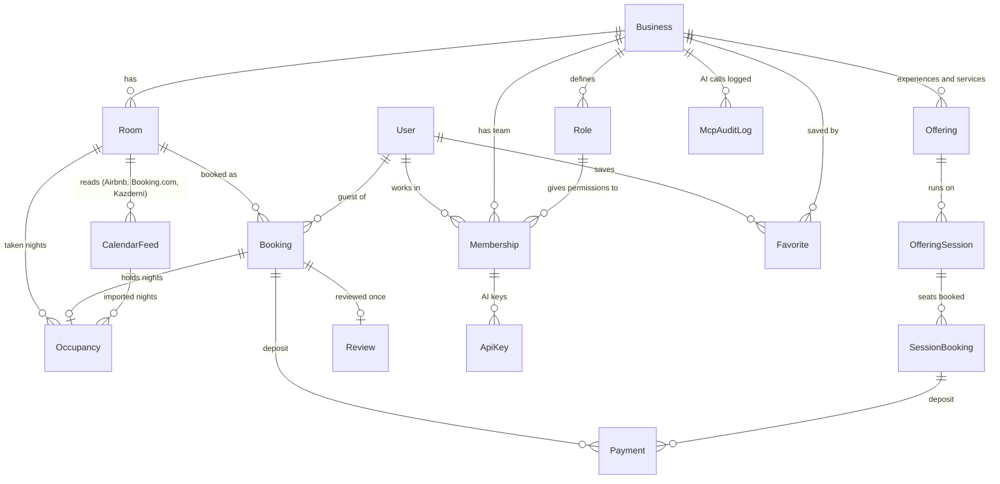

# Data model

The short version of the database. Every column of every table is in the [full diagram](erd.md), which is
generated from the code and always up to date.

## The core, in one picture

## What each table is for

**People and teams**

| Table        | In plain words                                                                       |
| ------------ | ------------------------------------------------------------------------------------ |
| `User`       | Anyone with an account: guest, host, staff or platform admin                         |
| `Business`   | One guesthouse or host (a "workspace"). Almost every other table belongs to one      |
| `Role`       | A role the owner built, holding a list of permissions. The Owner role holds them all |
| `Membership` | "This person works at this business with this role"                                  |

**Stays**

| Table          | In plain words                                                                              |
| -------------- | ------------------------------------------------------------------------------------------- |
| `Room`         | Something bookable by the night, with a base price and a private calendar link              |
| `RateOverride` | A special price for one room on one night                                                   |
| `Booking`      | A guest's request for a room, from "held" to confirmed, declined, expired or cancelled      |
| `Occupancy`    | Every taken night range, whatever the source. **This is where double bookings are stopped** |
| `CalendarFeed` | A platform calendar link we read on a schedule                                              |

**Experiences and services**

| Table             | In plain words                                                          |
| ----------------- | ----------------------------------------------------------------------- |
| `Offering`        | A hike, tasting, class, transfer or similar, priced per person or group |
| `OfferingSession` | One date and time it runs, with a number of seats                       |
| `SessionBooking`  | Seats requested by a guest. A database trigger stops overselling        |

**Money, trust and AI**

| Table         | In plain words                                                         |
| ------------- | ---------------------------------------------------------------------- |
| `Payment`     | A deposit the host recorded (Whish, OMT, bank, cash) or a card payment |
| `Review`      | One review per stay, only by the guest who stayed                      |
| `Favorite`    | A place a guest saved                                                  |
| `ActivityLog` | Who did what and when, for the activity feeds and admin actions        |
| `ApiKey`      | An AI key tied to one team member; only a hash is stored               |
| `McpAuditLog` | Every tool call an AI made, so owners can see what it looked at        |
| `AiUsage`     | AI spending per month, for the budget cap                              |

The remaining tables (`Session`, `Account`, `Verification`, `Oauth*`, `Jwks`) belong to sign-in and are managed by
Better Auth. `Category`, `Photo`, `StoredImage`, `RateLimitWindow`, `SiteSetting` and `WebhookEvent` are
supporting tables.

## The rules the database enforces itself

Prisma can't describe these, so they live in hand-written SQL migrations, and tests fail if one goes missing.

- **No overlapping stays.** For the same room, two active `Occupancy` rows can't share a night. Check-out day
  and the next check-in day don't clash.
- **No overselling seats.** A session never sells more seats than it has, even under many requests at once.
- **Sane values.** Check-out after check-in, at least one guest, ratings from 1 to 5, positive payments.
- **Platform nights may overlap each other** (Airbnb and Booking.com sometimes do), so imported rows are left out
  of the overlap rule. Direct requests are still checked against them, in code, while the room is locked.
