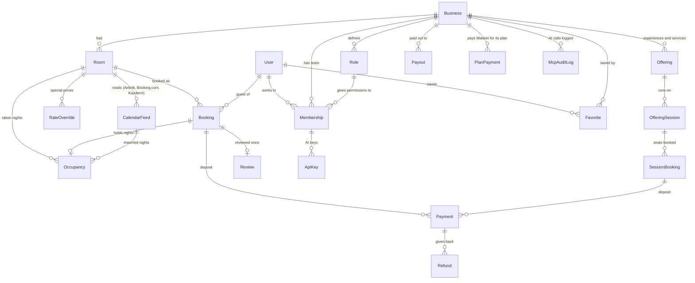

# Data model

The short version of the database. Every column of every table is in the [full diagram](erd.md), which is
generated from the code and always up to date.

## The core, in one picture

## Booking and Occupancy are different things

A `Booking` is the guest's request and what happens to it: held, confirmed, declined, expired or cancelled.
An `Occupancy` row says only "this room is taken on these nights". It comes from a booking (`DIRECT`), from
the host closing nights (`MANUAL`), or from an Airbnb or Booking.com calendar (`IMPORTED`). Availability, the
calendar, the exported iCal link and the double-booking rule all read `Occupancy`. When a booking ends, its
occupancy row goes inactive and the nights are free again. The [architecture](architecture.md#booking-vs-occupancy)
has the full picture.

## What each table is for

**People and teams**

| Table        | In plain words                                                                       |
| ------------ | ------------------------------------------------------------------------------------ |
| `User`       | Anyone with an account: guest, host, staff or platform admin                         |
| `Business`   | One guesthouse or host (a "workspace"). Almost every other table belongs to one      |
| `Role`       | A role the owner built, holding a list of permissions. The Owner role holds them all |
| `Membership` | "This person works at this business with this role"                                  |

**Stays**

| Table          | In plain words                                                                              |
| -------------- | ------------------------------------------------------------------------------------------- |
| `Room`         | Something bookable by the night, with a base price and a private calendar link              |
| `RateOverride` | A special price for one room on one night                                                   |
| `Booking`      | A guest's request for a room, from "held" to confirmed, declined, expired or cancelled      |
| `Occupancy`    | Every taken night range, whatever the source. **This is where double bookings are stopped** |
| `CalendarFeed` | A platform calendar link we read on a schedule                                              |

**Experiences and services**

| Table             | In plain words                                                          |
| ----------------- | ----------------------------------------------------------------------- |
| `Offering`        | A hike, tasting, class, transfer or similar, priced per person or group |
| `OfferingSession` | One date and time it runs, with a number of seats                       |
| `SessionBooking`  | Seats requested by a guest. A database trigger stops overselling        |

**Money, trust and AI**

| Table         | In plain words                                                                                                                           |
| ------------- | ---------------------------------------------------------------------------------------------------------------------------------------- |
| `Payment`     | Money for a booking: recorded by the host (Whish, OMT, bank, cash), or paid online through Mabeet (`online`), which Mabeet owes the host |
| `Refund`      | Money given back to a guest from an online payment; `PENDING` when an admin must send it by hand                                         |
| `Payout`      | A host asking Mabeet to send what it holds for them, to an IBAN or a Whish number                                                        |
| `PlanPayment` | A host paying for a plan (a Stripe invoice or a Whish month). Mabeet's only revenue                                                      |
| `Review`      | One review per stay, only by the guest who stayed                                                                                        |
| `Favorite`    | A place a guest saved                                                                                                                    |
| `ActivityLog` | Who did what and when, for the activity feeds and admin actions                                                                          |
| `ApiKey`      | An AI key tied to one team member; only a hash is stored                                                                                 |
| `McpAuditLog` | Every tool call an AI made, so owners can see what it looked at                                                                          |
| `AiUsage`     | AI spending per month, for the budget cap                                                                                                |

`WhishSandboxPayment` is the Whish simulator's own state, used only while `WHISH_MODE=simulator`.
`PushSubscription` holds the phones and browsers that turned on notifications, each following a person or one
booking.

The remaining tables (`Session`, `Account`, `Verification`, `Oauth*`, `Jwks`) belong to sign-in and are managed by
Better Auth. `Category`, `Photo`, `StoredImage`, `RateLimitWindow`, `SiteSetting` and `WebhookEvent` are
supporting tables.

## Job queues (the `pgboss` schema)

The worker's queues live in the same database, in a separate `pgboss` schema owned by
[pg-boss](https://github.com/timgit/pg-boss). It is not in `prisma/schema.prisma` and has no migrations of ours:
pg-boss creates and upgrades it when it starts.

| Table             | Holds                                                                                                  |
| ----------------- | ------------------------------------------------------------------------------------------------------ |
| `pgboss.job`      | One row per job: queue, `{ job, data }` payload, state (created → active → completed / failed), output |
| `pgboss.queue`    | The three queues (`ai`, `notify`, `cron`) with their retry and retention settings                      |
| `pgboss.schedule` | The worker's schedules: calendar sync every 15 minutes, housekeeping every 5                           |

Beside it, in our own schema, `JobProgress` holds what a running AI job has written so far (the tool in use and
the reply so far), so the person watches the answer arrive. The worker writes it at most every 300 ms and deletes
it when the job ends; housekeeping removes leftovers older than an hour.

What a job stores is kept small and short-lived. It holds ids and plain values, never a permission set. A
queued chat holds the conversation it answers. Finished AI jobs, with their answers, are deleted after an hour,
other jobs after a day. So a temporary chat, which is never saved in `AiChat`, also leaves the database within
the hour.

## The rules the database enforces itself

Prisma can't describe these, so they live in hand-written SQL migrations, and tests fail if one goes missing.

- **No overlapping stays** (`occupancy_no_overlap`). For the same room, two active `Occupancy` rows can't share
  a night. Check-out day and the next check-in day don't clash.
- **No overselling seats** (`session_seats_guard`, `session_capacity_guard`). A session never sells more seats
  than it has, even under many requests at once, and its capacity can't drop below what is sold.
- **Sane values.** Check-out after check-in (`occupancy_valid_range`, `booking_valid_range`,
  `session_valid_range`), at least one guest (`booking_positive_guests`), ratings from 1 to 5
  (`review_rating_range`), at least one seat, positive payments, refunds, payouts and plan payments
  (`payment_positive_amount`, …), no refund beyond the payment (`payment_refund_within_amount`), a payout always
  has its destination (`payout_has_destination`), and each payment
  and push subscription belonging to exactly one thing.
- **Platform nights may overlap each other** (Airbnb and Booking.com sometimes do), so imported rows are left out
  of the overlap rule. Direct requests are still checked against them, in code, while the room is locked.
