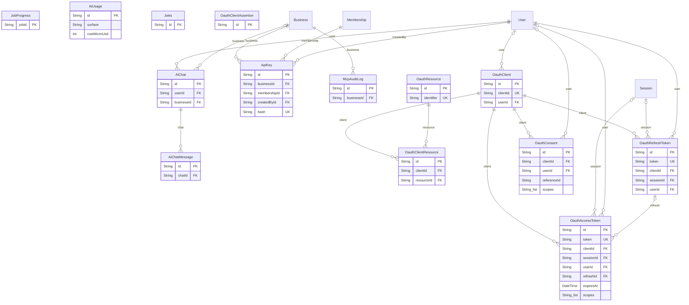
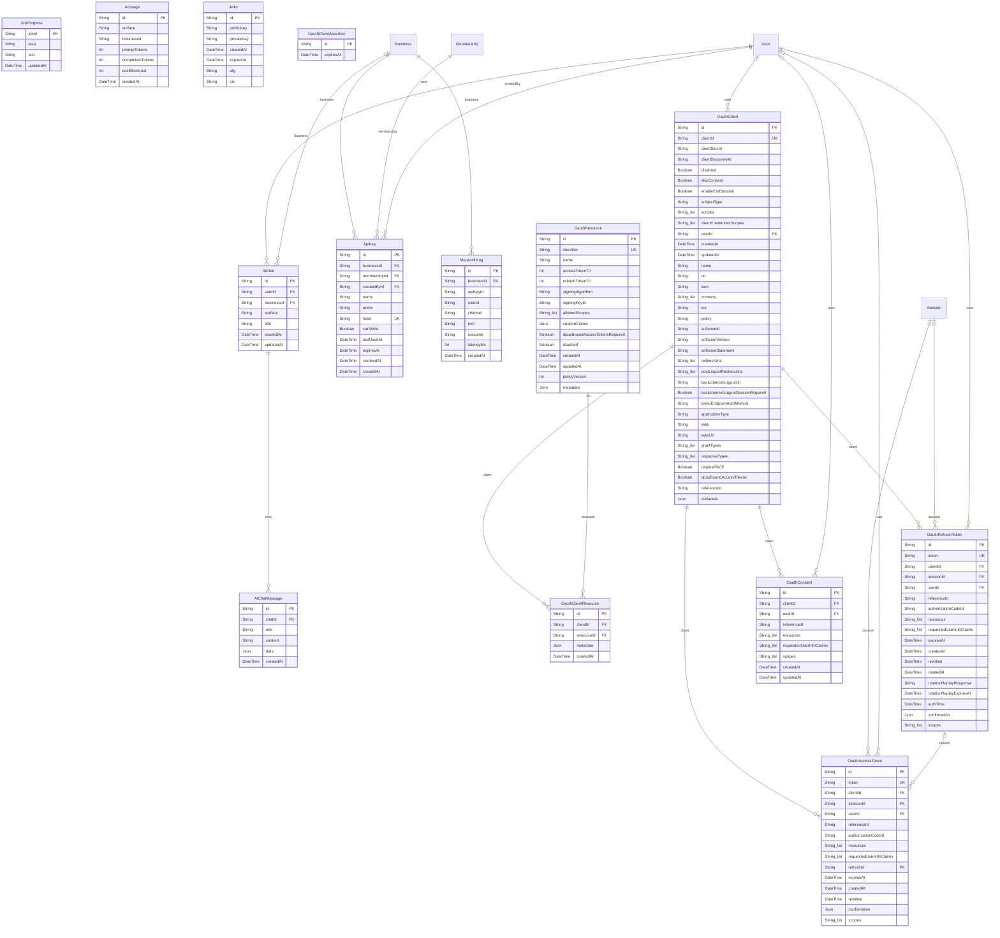

# Database diagram: AI and MCP

Generated from `prisma/schema.prisma` by `pnpm docs:erd`. Do not edit by hand. The assistants' saved chats and costs, live progress of queued answers, and AI apps connecting to a host's data:
personal API keys, OAuth (apps, consents, tokens, signing keys) and the log of every tool call. Boxes with no
columns (`User`, `Business`, …) are platform tables from [erd-platform.md](erd-platform.md), drawn only to show
where AI connects.

Not drawn here: the job queues. pg-boss keeps them in its own `pgboss` schema in the same database (jobs, queues,
schedules), creates and upgrades it itself, and nothing reads it through Prisma. See
[Queues and workers](architecture.md#queues-and-workers).

Only the keys, statuses, kinds and a few telling columns are shown; "Every column" below has the full tables. The
whole database in one diagram: [erd.md](erd.md).

Every column

