# Database diagram

Generated from `prisma/schema.prisma` by `pnpm docs:erd`. Do not edit by hand.

Guarantees that Prisma cannot express live in hand-written SQL migrations:

- `occupancy_no_overlap`: an EXCLUDE constraint, so no two active stays share a room night.
- `session_seats_guard`: a trigger, so a session never sells more seats than it has.
- CHECK constraints on date ranges, guest counts, ratings, seats and payments.

```mermaid
erDiagram
  User {
    String id PK
    String name
    String email UK
    Boolean emailVerified
    String image
    String phone
    String locale
    PlatformRole platformRole
    DateTime notificationsSeenAt
    DateTime createdAt
    DateTime updatedAt
  }
  AiChat {
    String id PK
    String userId FK
    String businessId FK
    String surface
    String title
    DateTime createdAt
    DateTime updatedAt
  }
  AiChatMessage {
    String id PK
    String chatId FK
    String role
    String content
    Json data
    DateTime createdAt
  }
  HostProfile {
    String userId PK, FK
    String displayName
    String bio
    String phone
    String whatsapp
    String city
    String_list languages
    Int hostingSince
    Boolean showOnListings
    HostContact contactBy
    DateTime createdAt
    DateTime updatedAt
  }
  Session {
    String id PK
    DateTime expiresAt
    String token UK
    String ipAddress
    String userAgent
    String userId FK
    String mcpBusinessId
    DateTime createdAt
    DateTime updatedAt
  }
  Account {
    String id PK
    String accountId
    String providerId
    String userId FK
    String accessToken
    String refreshToken
    String idToken
    DateTime accessTokenExpiresAt
    DateTime refreshTokenExpiresAt
    String scope
    String password
    DateTime createdAt
    DateTime updatedAt
  }
  Verification {
    String id PK
    String identifier
    String value
    DateTime expiresAt
    DateTime createdAt
    DateTime updatedAt
  }
  SiteSetting {
    String id PK
    String palette
    String updatedById
    DateTime updatedAt
  }
  Business {
    String id PK
    String name
    String slug UK
    String description
    String area
    String address
    Float latitude
    Float longitude
    String phone
    String whatsapp
    String timezone
    String currency
    Int lbpRate
    Int commissionRateBps
    Int depositPercent
    Int holdHours
    String depositInstructions
    String checkInTime
    String checkOutTime
    String houseRules
    String cancellationPolicy
    BookingUnit bookingUnit
    BookingMode bookingMode
    PaymentCollection paymentCollection
    OnlineAmount onlineAmount
    RefundPolicy refundPolicy
    Boolean listedPublicly
    String_list tags
    String_list accessibility
    Int minGuestAge
    BusinessStatus status
    Plan plan
    String stripeCustomerId UK
    String stripeSubscriptionId UK
    DateTime planRenewsAt
    DateTime createdAt
    DateTime updatedAt
  }
  Role {
    String id PK
    String businessId FK
    String name
    String description
    String_list permissions
    Boolean isOwner
    DateTime createdAt
    DateTime updatedAt
  }
  Membership {
    String id PK
    String userId FK
    String businessId FK
    String roleId FK
    MembershipStatus status
    DateTime createdAt
    DateTime updatedAt
  }
  Room {
    String id PK
    String businessId FK
    String name
    String description
    Int capacity
    Int bedrooms
    Int beds
    Int bathrooms
    Int baseRateCents
    Int minNights
    String_list amenities
    String exportToken UK
    RoomKind kind
    Boolean active
    DateTime createdAt
    DateTime updatedAt
  }
  Photo {
    String id PK
    String businessId FK
    String roomId FK
    String offeringId FK
    String url
    String alt
    PhotoArea area
    Int position
    DateTime createdAt
  }
  RateOverride {
    String id PK
    String businessId
    String roomId FK
    DateTime date
    Int rateCents
  }
  Category {
    String slug PK
    ListingKind kind
    String nameEn
    String nameAr
    String icon
    Int position
  }
  BusinessCategory {
    String businessId FK
    String categorySlug FK
  }
  CalendarFeed {
    String id PK
    String businessId FK
    String roomId FK
    String url
    FeedSource source
    DateTime lastSyncedAt
    String lastError
    DateTime createdAt
  }
  Booking {
    String id PK
    String reference UK
    String businessId FK
    String roomId FK
    String guestUserId FK
    String guestName
    String guestPhone
    String guestEmail
    Int guestCount
    String guestNote
    String locale
    DateTime checkIn
    DateTime checkOut
    Int totalCents
    Int depositCents
    String currency
    Int onlineDueCents
    RefundPolicy refundPolicy
    BookingStatus status
    String publicToken UK
    DateTime holdExpiresAt
    String decidedById
    DateTime decidedAt
    String cancelReason
    DateTime createdAt
    DateTime updatedAt
  }
  Occupancy {
    String id PK
    String businessId FK
    String roomId FK
    DateTime checkIn
    DateTime checkOut
    OccupancyKind kind
    Boolean active
    FeedSource source
    String note
    Boolean conflict
    String bookingId UK, FK
    String feedId FK
    String externalUid
    DateTime createdAt
    DateTime updatedAt
  }
  Payment {
    String id PK
    String businessId FK
    String bookingId FK
    String sessionBookingId FK
    Int amountCents
    String currency
    PaymentMethod method
    PaymentStatus status
    String providerRef UK
    String note
    String recordedById
    Boolean online
    String providerPaymentId
    String checkoutUrl
    DateTime paidAt
    Int refundedCents
    DateTime createdAt
  }
  Refund {
    String id PK
    String businessId FK
    String paymentId FK
    Int amountCents
    String currency
    RefundStatus status
    String reason
    String providerRef
    DateTime doneAt
    String doneById
    DateTime createdAt
  }
  Payout {
    String id PK
    String businessId FK
    Int amountCents
    String currency
    PayoutMethod method
    String accountName
    String bankName
    String iban
    String whishPhone
    PayoutStatus status
    String requestedById
    String reference
    String adminNote
    String decidedById
    DateTime decidedAt
    DateTime createdAt
  }
  PlanPayment {
    String id PK
    String businessId FK
    Plan plan
    Int amountCents
    String currency
    PaymentMethod method
    PaymentStatus status
    String providerRef UK
    String checkoutUrl
    DateTime paidAt
    DateTime createdAt
  }
  PlatformPaymentOption {
    String id PK
    PaymentMethod method
    String label
    String details
    Boolean active
    Int position
    DateTime createdAt
    DateTime updatedAt
  }
  PlanRequest {
    String id PK
    String businessId FK
    String requestedById FK
    Plan plan
    Int months
    Int amountCents
    String currency
    PaymentMethod method
    String payerReference
    String note
    String receiptMime
    Bytes receiptBytes
    PlanRequestStatus status
    String decidedById
    DateTime decidedAt
    String decisionNote
    DateTime createdAt
  }
  WhishSandboxPayment {
    String externalId PK
    String code UK
    String amount
    String currency
    String invoice
    String successCallbackUrl
    String failureCallbackUrl
    String successRedirectUrl
    String failureRedirectUrl
    String status
    String payerPhone
    DateTime createdAt
  }
  WebhookEvent {
    String id PK
    String provider
    String eventId
    Json payload
    DateTime receivedAt
  }
  Favorite {
    String id PK
    String userId FK
    String businessId FK
    DateTime createdAt
  }
  Review {
    String id PK
    String businessId FK
    String roomId FK
    String bookingId UK, FK
    String offeringId FK
    String sessionBookingId UK, FK
    String authorId FK
    Int rating
    Int cleanliness
    Int location
    Int value
    String comment
    String ownerReply
    ReviewStatus status
    String hiddenReason
    DateTime createdAt
  }
  ActivityLog {
    String id PK
    String userId FK
    String businessId FK
    String action
    String entity
    String entityId
    Json meta
    DateTime createdAt
  }
  ApiKey {
    String id PK
    String businessId FK
    String membershipId FK
    String createdById FK
    String name
    String prefix
    String hash UK
    Boolean canWrite
    DateTime lastUsedAt
    DateTime expiresAt
    DateTime revokedAt
    DateTime createdAt
  }
  McpAuditLog {
    String id PK
    String businessId FK
    String apiKeyId
    String userId
    String channel
    String tool
    String outcome
    Int latencyMs
    DateTime createdAt
  }
  Offering {
    String id PK
    String businessId FK
    ListingKind kind
    String slug UK
    String title
    String description
    String categorySlug FK
    String area
    String meetingPoint
    Float latitude
    Float longitude
    Int durationMinutes
    Int priceCents
    PriceUnit priceUnit
    Int maxGuests
    Int minAge
    ActivityLevel activityLevel
    SkillLevel skillLevel
    String_list included
    String_list notIncluded
    String_list accessibility
    String_list languages
    String_list tags
    Int cancellationHours
    Boolean active
    DateTime createdAt
    DateTime updatedAt
  }
  OfferingSession {
    String id PK
    String businessId FK
    String offeringId FK
    DateTime startsAt
    DateTime endsAt
    Int capacity
    Boolean active
    DateTime createdAt
  }
  SessionBooking {
    String id PK
    String reference UK
    String publicToken UK
    String businessId FK
    String offeringId FK
    String sessionId FK
    String guestUserId FK
    String guestName
    String guestPhone
    String guestEmail
    String guestNote
    String locale
    Int seats
    Int totalCents
    Int depositCents
    String currency
    Int onlineDueCents
    RefundPolicy refundPolicy
    BookingStatus status
    DateTime holdExpiresAt
    String decidedById
    DateTime decidedAt
    String cancelReason
    DateTime createdAt
    DateTime updatedAt
  }
  StoredImage {
    String id PK
    String businessId FK
    String mimeType
    Bytes bytes
    Int size
    DateTime createdAt
  }
  RateLimitWindow {
    String key PK
    Int count
    DateTime resetAt
  }
  AiUsage {
    String id PK
    String surface
    String businessId
    Int promptTokens
    Int completionTokens
    Int costMicroUsd
    DateTime createdAt
  }
  Jwks {
    String id PK
    String publicKey
    String privateKey
    DateTime createdAt
    DateTime expiresAt
    String alg
    String crv
  }
  OauthClient {
    String id PK
    String clientId UK
    String clientSecret
    String clientDiscoveryId
    Boolean disabled
    Boolean skipConsent
    Boolean enableEndSession
    String subjectType
    String_list scopes
    String_list clientCredentialsScopes
    String userId FK
    DateTime createdAt
    DateTime updatedAt
    String name
    String uri
    String icon
    String_list contacts
    String tos
    String policy
    String softwareId
    String softwareVersion
    String softwareStatement
    String_list redirectUris
    String_list postLogoutRedirectUris
    String backchannelLogoutUri
    Boolean backchannelLogoutSessionRequired
    String tokenEndpointAuthMethod
    String applicationType
    String jwks
    String jwksUri
    String_list grantTypes
    String_list responseTypes
    Boolean requirePKCE
    Boolean dpopBoundAccessTokens
    String referenceId
    Json metadata
  }
  OauthResource {
    String id PK
    String identifier UK
    String name
    Int accessTokenTtl
    Int refreshTokenTtl
    String signingAlgorithm
    String signingKeyId
    String_list allowedScopes
    Json customClaims
    Boolean dpopBoundAccessTokensRequired
    Boolean disabled
    DateTime createdAt
    DateTime updatedAt
    Int policyVersion
    Json metadata
  }
  OauthClientResource {
    String id PK
    String clientId FK
    String resourceId FK
    Json metadata
    DateTime createdAt
  }
  OauthRefreshToken {
    String id PK
    String token UK
    String clientId FK
    String sessionId FK
    String userId FK
    String referenceId
    String authorizationCodeId
    String_list resources
    String_list requestedUserInfoClaims
    DateTime expiresAt
    DateTime createdAt
    DateTime revoked
    DateTime rotatedAt
    String rotationReplayResponse
    DateTime rotationReplayExpiresAt
    DateTime authTime
    Json confirmation
    String_list scopes
  }
  OauthAccessToken {
    String id PK
    String token UK
    String clientId FK
    String sessionId FK
    String userId FK
    String referenceId
    String authorizationCodeId
    String_list resources
    String_list requestedUserInfoClaims
    String refreshId FK
    DateTime expiresAt
    DateTime createdAt
    DateTime revoked
    Json confirmation
    String_list scopes
  }
  OauthConsent {
    String id PK
    String clientId FK
    String userId FK
    String referenceId
    String_list resources
    String_list requestedUserInfoClaims
    String_list scopes
    DateTime createdAt
    DateTime updatedAt
  }
  OauthClientAssertion {
    String id PK
    DateTime expiresAt
  }
  PushSubscription {
    String id PK
    String endpoint
    String p256dh
    String auth
    String userId FK
    String bookingToken
    DateTime createdAt
  }
  User ||--o{ AiChat : "user"
  Business |o--o{ AiChat : "business"
  AiChat ||--o{ AiChatMessage : "chat"
  User ||--o{ HostProfile : "user"
  User ||--o{ Session : "user"
  User ||--o{ Account : "user"
  Business ||--o{ Role : "business"
  User ||--o{ Membership : "user"
  Business ||--o{ Membership : "business"
  Role ||--o{ Membership : "role"
  Business ||--o{ Room : "business"
  Business ||--o{ Photo : "business"
  Room |o--o{ Photo : "room"
  Offering |o--o{ Photo : "offering"
  Room ||--o{ RateOverride : "room"
  Business ||--o{ BusinessCategory : "business"
  Category ||--o{ BusinessCategory : "category"
  Business ||--o{ CalendarFeed : "business"
  Room ||--o{ CalendarFeed : "room"
  Business ||--o{ Booking : "business"
  Room ||--o{ Booking : "room"
  User |o--o{ Booking : "guestUser"
  Business ||--o{ Occupancy : "business"
  Room ||--o{ Occupancy : "room"
  Booking |o--o| Occupancy : "booking"
  CalendarFeed |o--o{ Occupancy : "feed"
  Business ||--o{ Payment : "business"
  Booking |o--o{ Payment : "booking"
  SessionBooking |o--o{ Payment : "sessionBooking"
  Business ||--o{ Refund : "business"
  Payment ||--o{ Refund : "payment"
  Business ||--o{ Payout : "business"
  Business ||--o{ PlanPayment : "business"
  Business ||--o{ PlanRequest : "business"
  User |o--o{ PlanRequest : "requestedBy"
  User ||--o{ Favorite : "user"
  Business ||--o{ Favorite : "business"
  Business ||--o{ Review : "business"
  Room |o--o{ Review : "room"
  Booking |o--o| Review : "booking"
  Offering |o--o{ Review : "offering"
  SessionBooking |o--o| Review : "sessionBooking"
  User |o--o{ Review : "author"
  User |o--o{ ActivityLog : "user"
  Business |o--o{ ActivityLog : "business"
  Business ||--o{ ApiKey : "business"
  Membership ||--o{ ApiKey : "membership"
  User ||--o{ ApiKey : "createdBy"
  Business ||--o{ McpAuditLog : "business"
  Business ||--o{ Offering : "business"
  Category |o--o{ Offering : "category"
  Business ||--o{ OfferingSession : "business"
  Offering ||--o{ OfferingSession : "offering"
  Business ||--o{ SessionBooking : "business"
  Offering ||--o{ SessionBooking : "offering"
  OfferingSession ||--o{ SessionBooking : "session"
  User |o--o{ SessionBooking : "guestUser"
  Business ||--o{ StoredImage : "business"
  User |o--o{ OauthClient : "user"
  OauthClient ||--o{ OauthClientResource : "client"
  OauthResource ||--o{ OauthClientResource : "resource"
  OauthClient ||--o{ OauthRefreshToken : "client"
  Session |o--o{ OauthRefreshToken : "session"
  User ||--o{ OauthRefreshToken : "user"
  OauthClient ||--o{ OauthAccessToken : "client"
  Session |o--o{ OauthAccessToken : "session"
  User |o--o{ OauthAccessToken : "user"
  OauthRefreshToken |o--o{ OauthAccessToken : "refresh"
  OauthClient ||--o{ OauthConsent : "client"
  User |o--o{ OauthConsent : "user"
  User |o--o{ PushSubscription : "user"
```

